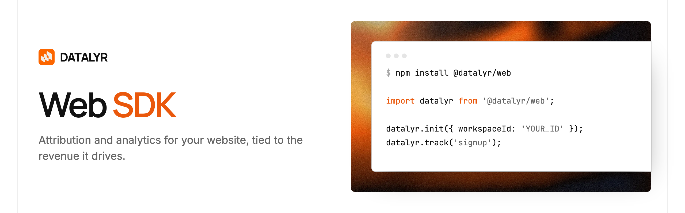

<picture>
  <source media="(prefers-color-scheme: dark)" srcset=".github/assets/banner-dark.png">
  
</picture>

<p align="center">
  <a href="https://www.npmjs.com/package/@datalyr/web"></a>
  <a href="https://github.com/datalyr/web/actions/workflows/ci.yml"></a>
  <a href="LICENSE"></a>
  <a href="https://docs.datalyr.com/sdk-reference/web"></a>
</p>

# DATALYR Web SDK

Track your website with DATALYR and see which channel, campaign and ad drove every conversion.

- **Attribution.** Click IDs, UTMs and ad cookies are captured on landing and kept with the visitor.
- **One customer, every visit.** Anonymous visits join the signed-in user when you call `identify()`.
- **Better ad signal.** Conversions reach your ad platforms with the data they need to optimize.
- **Privacy built in.** Consent, Global Privacy Control and opt-out are respected.

## Install

Use **one** of these two options. If you load both, one visitor gets two `visitor_id` values.

**Script tag** (no build step):

```html
<script defer src="https://track.datalyr.com/dl.js"
        data-workspace-id="YOUR_WORKSPACE_ID"></script>
```

**npm:**

```bash
npm install @datalyr/web
```

Find your workspace ID in DATALYR under **Settings → Tracking → Install**.

## Quick start

```javascript
import datalyr from '@datalyr/web';

datalyr.init({ workspaceId: 'YOUR_WORKSPACE_ID' });

// Page views are tracked for you, including SPA route changes.

// Track an action
datalyr.track('signup_started', { plan: 'pro' });

// Tie the visitor to your user after sign-in
datalyr.identify('user_123', { email: 'user@example.com' });

// Record a conversion with its value
datalyr.track('purchase', { value: 49.0, currency: 'USD' });

// On logout only
datalyr.reset();
```

With the script tag, the SDK calls `init()` for you. The same methods are on `window.datalyr`.

## Check it works

1. Open your site in a private window.
2. In DATALYR, open **Events**.
3. Confirm that a `pageview` with your URL arrives within 30 seconds.

If no event arrives, add `debug: true` to `init()`. Then read the browser console.

## Set up with an AI agent

Your AI agent can install the SDK for you. Connect the agent to the DATALYR MCP server at `https://mcp.datalyr.com/mcp`. Then ask it to install tracking. See [DATALYR MCP](https://docs.datalyr.com/datalyr-mcp).

## Documentation

- [Web SDK reference](https://docs.datalyr.com/sdk-reference/web): every method, option and event
- [Changelog](CHANGELOG.md)
- Other SDKs: [React Native](https://github.com/datalyr/react-native) · [iOS (Swift)](https://github.com/datalyr/swift) · [Node](https://github.com/datalyr/api)

## Support

- Bugs and feature requests: [open an issue](https://github.com/datalyr/web/issues/new/choose)
- Security reports: see [SECURITY.md](SECURITY.md)
- Other questions: [datalyr.com](https://datalyr.com)

## License

MIT. See [LICENSE](LICENSE).
